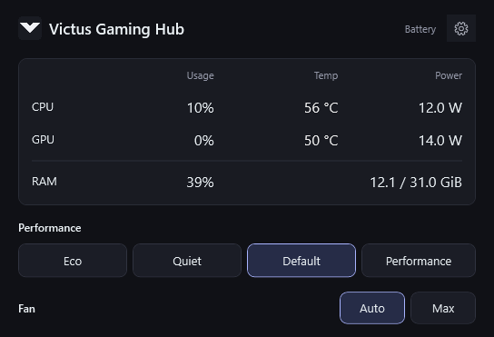

# Victus Gaming Hub

A compact, local Windows control panel for HP Victus. Version **0.2.0** targets the tested **Victus 15-fb3xxx, board 8DD2, BIOS F.15**. Other board/BIOS combinations are rejected.



## Install

[Download Setup.exe](https://github.com/batuhanberk06/victus-gaming-hub/releases/latest/download/Setup.exe), run it, and approve the Windows administrator prompt. Setup installs into `C:\Program Files\VictusHub`, registers the private local control service, and adds a Start menu shortcut.

- **Start with Windows** creates a shortcut in the installing user's Startup folder. The app starts in the system tray. This can be changed in Settings; legacy Run entries are migrated to avoid duplicate startup.
- **CPU temperature and power (PawnIO)** opens the official signed PawnIO installer if it is absent. Use the standard installation. Existing PawnIO is retained, including when Victus Gaming Hub is removed.
- The .NET runtime is included. No developer SDK is needed.

The app runs as a normal user. Only its local service performs privileged hardware access; access is restricted to the configured account. No OEM DLLs are redistributed. There is no network feature in the app.

## Features

- RAM usage; CPU usage, temperature and package power; NVIDIA GPU usage, temperature and power.
- Yellow temperature at 80–89 °C, red at 90 °C and above.
- Eco, Quiet, Default and Performance requests on AC and battery, plus Auto/Max fan control. Eco uses Auto.
- Eco caps refresh at 60 Hz at the current resolution and NVIDIA FPS at 60, preserving a lower existing cap. Owned changes are restored when leaving Eco or exiting.
- Compact English UI, system tray controls, optional startup, and close-to-tray.

On battery, the app sends the tested legacy firmware profile/fan commands but **does not write the AC GPU boost preset**. The BIOS can itself adjust its GPU policy when applying a profile. Battery power limits remain controlled by firmware. Performance on battery does not promise AC-level performance.

## Verification and limits

- Four profile commands and Max → Auto passed on real DC, with BIOS return codes and fan readback recorded. The GPU policy was observed to change in firmware after Performance and return on Default/Eco.
- Firmware does not expose a verified active-profile name getter. A highlighted profile is the last successfully requested profile, not an independently read active mode.
- Exact OEM adaptive CPU/GPU power-sharing algorithms and the optional OEM DC auto-fan configuration flag are not reproduced. No arbitrary EC access, custom watt limits or power unlocking is provided.
- CPU temperature/power were tested on Ryzen AI 7 350 using LibreHardwareMonitor 0.9.6 and PawnIO 2.2.0. Without sensor access those fields stay unavailable.
- Sleep/wake and post-OMEN-removal operation were checked by the user. The Startup folder shortcut passed local launch/toggle tests; the user subsequently confirmed that the final setup and automatic startup work.

## Remove

Use Windows Settings → Apps → Victus Gaming Hub → Uninstall. The uninstaller requests graceful exit, restores Default + Auto and owned FPS settings, removes the service and startup/Start menu shortcuts, then deletes only its fixed Program Files directory. If restoration fails, installation is preserved. User preferences and separately installed PawnIO remain.

## Build

Requires .NET 10 SDK. The development machine uses `.tools/dotnet` without changing the system SDK/PATH.

```powershell
.\scripts\Build.ps1
.\scripts\Build.ps1 -Package
.\scripts\Build-Setup.ps1
```

The setup build uses the portable NSIS 3.11 compiler in `.tools/installer/nsis-3.11` and the official signed PawnIO 2.2.0 installer in `.tools/sensors`. Build inputs and checksums are documented in `docs/RELEASE-0.2.0.md`. Output: `artifacts/Setup.exe` and `artifacts/Setup.sha256`.

## Diagnostics CLI

```powershell
VictusHub.Probe.exe --telemetry
VictusHub.Probe.exe --desktop-state
VictusHub.Probe.exe --control Status
VictusHub.Probe.exe --control Telemetry
VictusHub.Probe.exe --snapshot # admin; fixed read-only BIOS queries
```

Control commands accept only fixed actions. There is no raw BIOS command API. Local logs/reports can contain device information; review them before sharing.

Source is GPL-3.0-or-later. Third-party licenses and the requested HP Victus mark are described in THIRD-PARTY-NOTICES.md. This is an independent project, not an official HP product.


