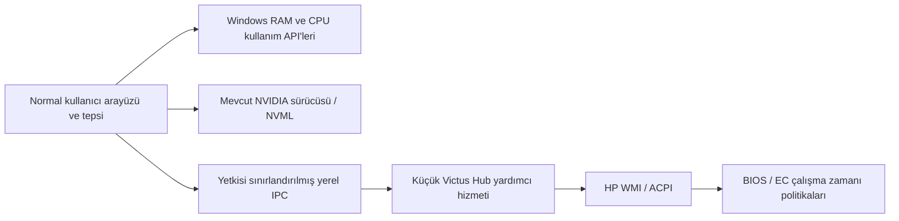

# Victus Hub — araştırma ve uygulama planı

Tarih: 14 Ekim 2026 (Europe/Istanbul). Durum: yalnızca araştırma ve planlama; uygulama geliştirme ve kurulum başlamadı.

## Karar

OMEN Gaming Hub'ın temel profil ve fan işlevlerini hafif, açık kaynak bir Windows uygulamasında gerçekleştirmek teknik olarak mümkün görünüyor. Uygun başlangıç yolu, HP'nin ACPI üzerinden sunduğu WMI BIOS arayüzü. Bu arayüzün mevcut cihazda sınıfları görüldü; profil/fan komutları bu araştırmada çalıştırılmadı. Dört profilin birebir davranışı ve Auto'ya dönüş cihaz üzerinde doğrulanmadan tam uyumluluk iddiası yapılmayacak.

İlk sürüm yalnızca kullanıcının cihazına odaklanacak. Ek kernel/sensör sürücüsü kurulmayacak. Mevcut arayüzlerle güvenilir okunamayan sensörler eksik kalabilecek; kullanıcı bunu kabul etti.

## Kullanıcının kesinleştirdiği kapsam

- OMEN'de mevcut Eco, Quiet, Default ve Performance profilleri.
- Profil destekliyorsa Auto ve Max fan seçimi.
- RAM kullanımı; CPU kullanımı, sıcaklığı ve gücü; GPU kullanımı, sıcaklığı ve gücü.
- Windows ile otomatik başlama seçeneği.
- Önce kendi Victus'unda güvenilir çalışma, ardından başka modeller.
- Yeni sürücü kurulumu yok; eksik sensör için açık bir destek durumu.

## Yerel olarak gözlenen cihaz

| Alan | Değer |
|---|---|
| Model | Victus by HP Gaming Laptop 15-fb3xxx |
| HP ürün kodu | C21PCEA#AB8 |
| Anakart ProductId | 8DD2 |
| BIOS | F.15, tarih 27 Nisan 2026 |
| İşlemci | AMD Ryzen AI 7 350 |
| Dahili GPU | AMD Radeon 860M |
| Harici GPU | NVIDIA GeForce RTX 5060 Laptop GPU |
| Bellek | 32 GB sınıfı; Windows'un kullanılabilir fiziksel toplamı yaklaşık 31 GiB   |
| İşletim sistemi | Windows 11 Home, build 26200 |
| OMEN Gaming Hub | AD2F1837.OMENCommandCenter, 1101.2609.11.0 |

Salt okunur envanterde `root\wmi:hpqBIntM` ve `hpqBIOSInt0/4/128/1024/4096` metotları bulundu. `hpqBDataIn` sınıfındaki Command, CommandType, Sign, Size ve hpqBData alanları da mevcut. ACPI WMI cihazı Microsoft'un `wmiacpi.inf` sürücüsünü kullanıyor. Bu, yeni bir kontrol sürücüsü yazmadan mevcut WMI yolunu denemek için somut dayanak.

Mevcut yetkisiz oturumdan `hpqBIntM` örnek okuması Access denied döndürdü. Dolayısıyla arayüzün varlığı doğrulandı, yetkili komut alışverişi henüz doğrulanmadı. Sonraki geliştirme aşamasında normal WMI/System.Management yolu ve gerekli erişim yetkisi sınanacak; erişim denetimleri değiştirilmeyecek.

`HPOmenCap` (HP Omen HSA Service) ve HP yardımcı hizmetleri kurulu/çalışır durumda. OMEN UI, OEM hizmetleri ve sürücü paketleri ayrı bileşenler olarak ele alınacak. Hiçbir hizmet durdurulmadı, paket kaldırılmadı veya BIOS/fan/profil ayarı değiştirilmedi.

Tek seferlik salt okunur NVIDIA sorgusu, mevcut sürücüyle GPU kullanımı/sıcaklığı/gücü alanlarını başarıyla döndürdü: %0, 57 °C, 14,21 W. Bu anlık örnek, üç alanın bu kurulumda okunabildiğini gösterir; normal boşta güç tüketimi veya uyandırmasız okuma kanıtı değildir.

## Dış kaynak bulguları ve sınırları

### WMI ve mevcut projeler

[OmenMon](https://github.com/OmenMon/OmenMon) WMI BIOS ve EC erişimiyle hafif bir Windows uygulamasının mümkün olduğuna örnek. [OmenHwCtl](https://github.com/GeographicCone/OmenHwCtl) daha küçük bir komut satırı/protokol referansı. [OmenCore](https://github.com/theantipopau/omencore) güncel WMI uygulaması ve model ayrımları açısından yararlı; kapsamı Victus Hub V1'den geniş.

OmenCore'un incelenen `2f8772cd9c43051b3c9a0c8d27785b902df5785e` commit'inde 8DD2 için doğrudan kayıt var. WMI fan/profil kontrolü etkin öngörülüyor; doğrudan EC yazımı kapalı ve `UserVerified=false`. Kayıt, kimlik teyidiyle önceki aile kaydından türetilmiş. Bu nedenle 8DD2'nin tüm özellikleri test edilmiş kabul edilemez; fan sayısı, aydınlatma ve diğer bayraklar da körlemesine aktarılmayacak. [Model kaydı](https://github.com/theantipopau/omencore/blob/2f8772cd9c43051b3c9a0c8d27785b902df5785e/src/OmenCore.Core/Hardware/ModelCapabilityDatabase.cs#L1944), [kimlik bildirimi #197](https://github.com/theantipopau/omencore/issues/197).

Kaynakta görülen protokol adayları aşağıdadır. Bunlar araştırma bulgusudur; bu cihazda doğrulanmış komut tarifi değildir.

| İşlem | Kaynaktaki CommandType |
|---|---|
| Sistem/yetenek bilgisi | 0x28 |
| Termal/performans politikası seçimi | 0x1A |
| Max fan durumunu okuma | 0x26 |
| Max fan durumunu değiştirme | 0x27 |
| Fan seviyesi okuma | 0x2D |
| Genel termal sensör okuma | 0x23 |

Bu işlemlerde temel komut grubu `0x20008`. WMI paket alanları ve dönüş kodu ayrı ayrı denetlenmeli. Kaynaklarda eski/yeni termal politika için farklı profil değerleri var; Quiet/Cool veya Eco adlarından sayısal değer türetilmeyecek. Özellikle `0x23` dönüşü genel termal sensör olarak belgelenmiş; CPU junction sıcaklığı olduğu doğrulanmadan “CPU sıcaklığı” adıyla gösterilemez. [OmenMon protokol kaynağı](https://github.com/OmenMon/OmenMon/blob/d89340e6d4dc9802b609390729b0bfaec05563e2/Hardware/BiosCtl.cs), [OmenCore WMI uygulaması](https://github.com/theantipopau/omencore/blob/2f8772cd9c43051b3c9a0c8d27785b902df5785e/src/OmenCore.Core/Hardware/HpWmiBios.cs).

### Eco ve Auto'ya dönüş

HP'nin genel OMEN açıklaması Eco'nun Auto fan, ekran yenileme hızı ve CPU/GPU güç davranışlarını birlikte değiştirebildiğini söylüyor. Belgedeki Intel Turbo Boost maddesi bu AMD cihaza otomatik olarak uygulanamaz. Kullanıcının cihazındaki gerçek Eco politikası ayrıca gözlenmeli. [HP açıklaması](https://support.hp.com/gb-en/document/ish_3912817-3737596-16?pStoreID=contenttest).

OmenCore kaynaklarında Max'tan Auto'ya dönüş için modele/politika sürümüne bağlı ek işlemler bulunuyor. Basitçe Max bayrağını kapatmanın yeterli olduğu varsayılmayacak; başka cihazlara ait fan seviyesi yazımı da aktarılmayacak. Çalışan dönüş sırası yalnızca bu cihaz üzerinde doğrulandıktan sonra kaydedilecek.

### Kurulu OEM bileşenine statik bakış

REA ile kurulu `HP.Omen.PerformanceControlModule.dll` metadata'sı incelendi: .NET Framework 4.8, PerformanceControl 1.0.37.0 ve RpcClient gibi bağımlılıklar görüldü. Evidence: `ev_9c55235aab82cb561af3ef43eab19b34416fcbdd0b207a98d537fcef8a58b68b`.

Kurulu `PerformanceControl.dll` statik üye incelemesinde Eco dahil performans enum'u ve Auto/Max/Manual termal enum'u görüldü. Evidence: `ev_5ec074768b2b2cb6bfb257369fb0e525f60196e817ec8f57ce81f457729b351e`; SHA-256: `8666cc0b521f223f1271eea361c148e9b4c14128b792363a3cdbef24ee31f18b`, MVID: `1e35c328-432a-474e-8901-1e61f065e79c`.

İkinci incelemenin kapsamı partial. Assembly çalıştırılmadı veya CLR'ye yüklenmedi; metadata/IL gözlemi runtime davranışını ve dört profilin komut eşleşmesini kanıtlamaz. Kesin cihaz eşleştirmesi gerekirse sonraki aşamada OEM çağrı zinciri daha dar kapsamla incelenecek. HP DLL'lerini dağıtımımıza eklemek mimari gereksinim olarak kabul edilmeyecek.

## Sürücüsüz telemetri planı

| Veri | Birinci yol | V1 kabul durumu |
|---|---|---|
| RAM, % ve kullanılan/toplam GiB | GlobalMemoryStatusEx | Ek sürücü gerektirmeyen Windows API |
| CPU kullanımı, % | GetSystemTimes örnek farkları | Ek sürücü gerektirmeyen Windows API |
| CPU sıcaklığı, °C | Mevcut HP WMI/OEM'nin erişilebilir, anlamı doğrulanmış sensörü | Koşullu; genel ACPI/termal bölge CPU diye sunulmaz |
| CPU paket gücü, W | Mevcut ve belgelenebilir sürücüsüz OEM arayüzü bulunursa | Henüz uygun yol doğrulanmadı; desteklenmiyor olabilir |
| RTX 5060 kullanımı, sıcaklığı, gücü | Mevcut NVIDIA sürücüsünden doğrudan NVML | Üç alan yerel nvidia-smi sorgusunda mevcut |
| Radeon 860M | Ayrı, ikincil GPU bilgisi; mevcut API desteğine göre | RTX ile karıştırılmayacak; eksik alanlar açık gösterilecek |

GPU sorgusu için her örneklemede nvidia-smi süreci başlatılmayacak; NVML doğrudan çağrılacak. Güç mW'den W'a çevrilecek; toplam laptop tüketimi veya ayarlanmış güç limiti olarak etiketlenmeyecek. CPU gücü de okunabilirse CPU paket gücü adıyla sunulacak; TDP veya kullanım yüzdesinden tahmin edilmeyecek. [NVML](https://docs.nvidia.com/deploy/nvml-api/latest/api/group__nvmlDeviceQueries.html), [bellek API'si](https://learn.microsoft.com/en-us/windows/win32/api/sysinfoapi/nf-sysinfoapi-globalmemorystatusex), [CPU zaman API'si](https://learn.microsoft.com/en-us/windows/win32/api/processthreadsapi/nf-processthreadsapi-getsystemtimes).

Araştırılan LibreHardwareMonitor/PawnIO yolu, AMD Family 1Ah için genel sıcaklık ve enerji sayacı okuyabilen bir adaydır; yeni mobil SMU tabloları için eksikler var. Kullanıcının tercihi nedeniyle V1'e alınmadı. [CPU seçimi](https://github.com/LibreHardwareMonitor/LibreHardwareMonitor/blob/master/LibreHardwareMonitorLib/Hardware/Cpu/CpuGroup.cs), [AMD okuma yolu](https://github.com/LibreHardwareMonitor/LibreHardwareMonitor/blob/master/LibreHardwareMonitorLib/Hardware/Cpu/Amd17Cpu.cs), [SMU kapsamı](https://github.com/LibreHardwareMonitor/LibreHardwareMonitor/blob/master/LibreHardwareMonitorLib/Hardware/RyzenSMU.cs).

## Önerilen ürün ve mimari

Tek kompakt pencere: RAM/CPU/RTX kartları, dört profil düğmesi, desteklenen fan seçimi ve ayarlar. Ölçümün zamanı, birimi ve durumu belirli olacak. İstenen profil ile cihazdan doğrulanabilen durum ayrılacak. Desteksiz, erişim hatası, eski veri ve uyuyan GPU ayrı durumlar olacak; bilinmeyen değer sıfır gösterilmeyecek.

Başlangıç teknoloji önerisi: C# + .NET 10 LTS + WPF; Windows 11 x64 hedefi. Bu, Windows servisleri/WMI entegrasyonu ve bakımı için uygun bir tercih; kaynak tüketimi ölçümleriyle kabul edilecek. [WPF](https://learn.microsoft.com/en-us/dotnet/desktop/wpf/overview/), [.NET destek politikası](https://dotnet.microsoft.com/en-us/platform/support/policy/dotnet-core).

Yardımcı hizmet bir kernel sürücüsü değildir; mevcut Windows arayüzlerine gerekli yetkiyle erişen kullanıcı alanı bileşenidir. UI normal kullanıcı olarak çalışacak. Hizmet hesabı için gerekli en düşük yetki prototipte belirlenecek. Yerel named pipe erişimi kullanıcı/hizmet kimliğiyle sınırlandırılacak; yalnızca tanımlı profil/fan işlemleri kabul edilecek. Firmware işlemleri tek sıradan geçecek; zaman aşımı, sınırlı yeniden deneme ve anlaşılır sonuç kaydı olacak.

Sensörler başlangıçta pencere açıkken 1–2 saniye, tepside görünür sensör varsa 5–10 saniye aralıklarla okunacak. Sensör göstergesi yokken yüksek sıklıklı telemetri duracak. Pilde NVML okumalarının RTX'i uyanık tutup tutmadığı ölçülecek; gerekiyorsa arka plandaki NVIDIA okumaları durdurulacak.

Hafiflik için ilk ölçülebilir hedefler: tepside UI+hizmet toplam özel çalışma kümesi 100 MB altında, pencere açıkken 150 MB altında; normal tepsi kullanımında 60 saniyelik ortalama CPU %1 altında; bu cihazda kullanılabilir arayüz yaklaşık 2 saniye içinde. Bunlar ölçülmemiş kabul hedefleridir. RAM ölçümüne ortak sayfaları iki kez eklememek için süreç başına Private Working Set kullanılacak. Paket/disk boyutu ayrıca raporlanacak; self-contained .NET paketinin büyüklüğü çalışan uygulamanın RAM maliyetiyle karıştırılmayacak.

## Geliştirme sırası ve çıkış ölçütleri

1. **Cihaza özel kanıt tablosu.** Yetkili erişimle yalnızca gerekli WMI sorgularını doğrula. Her OEM profili için termal politika sürümü, profil seçimi, fan seçenekleri, Windows güç politikası ve Eco'nun ekran/GPU etkilerini kaydet. Genel komut taraması yerine bilinen işlemler ve hedefli statik inceleme kullan. Çıkış: her özellik için doğrulanmış, koşullu veya desteklenmiyor sonucu.
2. **En küçük kontrol prototipi.** Sadece doğrulanmış dört profil ve Auto/Max işlemlerini uygula. Başlangıç durumunu kaydet, her geçişi seri uygula, mevcut readback ile kontrol et. Readback olmayan alanı doğrulanmış gösterme. Max → Auto ve Eco'ya giriş/çıkış, ekran/güç ayarlarının geri dönüşü geçmeden sonraki aşamaya ilerleme.
3. **Telemetri sağlayıcıları.** Windows RAM/CPU ve doğrudan NVML sağlayıcılarını ekle. CPU sıcaklık/güç için mevcut arayüz kanıtı varsa ekle; yoksa alanları desteklenmiyor bırak. Böyle bir eksik metrik, çalışan profil/fan kontrolünü engellemesin.
4. **Arayüz, tepsi ve tercihler.** Dört profil, fan seçimi, başlangıç ayarı, sessiz tepsi başlangıcı ve tek uygulama örneği. Profil/fan uyumluluğu doğrulanan cihaz tablosundan gelsin. Ayarlar sürümlü kullanıcı dosyasında saklansın.
5. **Kurulum ve OEM'den geçiş.** Önce uygulama+hizmet kurulum/kaldırma yaşam döngüsünü doğrula. Ardından OMEN kontrol bileşenleri kapalıyken çalışma ve yeniden başlatma testini yap. Başarı kanıtlandıktan sonra OMEN Gaming Hub kaldırılmış durumda doğrula; gerçekten gereken HP bileşeni varsa açıkça belgeleyerek koru. OMEN uygulamasını kaldırmak, tüm HP DriverStore paketlerini kaldırmak olarak uygulanmasın.
6. **Kabul ve yayın.** Tüm profil geçişleri, destekli fan kombinasyonları, pil/şarj geçişi, uyku/uyanma, yeniden başlatma, UI/hizmet hatası ve kaldırma sınansın. Kaynak tüketimi ve GPU uyku etkisi ölçülsün. V1 yalnızca doğrulanan 8DD2/BIOS yapılandırması için destek ilan etsin; BIOS değişikliği yeniden yetenek doğrulaması gerektirsin.

OMEN karşılaştırmasında aynı iş yükü, benzer ortam/sıcaklık, aynı şarj durumu ve tekrarlı ölçümler kullanılacak. Tek bir watt/sıcaklık örneğiyle profil eşdeğerliği kanıtlanmayacak. Fan seviyesi gerçek tachometer RPM değilse “tahmini” olarak etiketlenecek.

## Kurulum, otomatik başlangıç ve kaldırma

Kurulum, tek yönetici onayıyla programı ve dar kapsamlı hizmeti kaydedecek. Varsayılan ilk açılışta mevcut ayarlar okunacak; otomatik profil değişikliği ancak kullanıcı tercihiyle etkinleşecek. Yeni sürücü, PawnIO veya WinRing0 kurulmayacak; mevcut Windows güvenlik ayarları korunacak.

“Windows ile başlat” mevcut kullanıcı oturum açtığında tepsi uygulamasını başlatacak. Hizmetin yaşam döngüsü bu tercihle uyumlu olacak: otomatik başlangıç kapalıyken açılışta profil uygulamayacak; UI elle açıldığında gerektiğinde başlatılacak. Bir UI penceresini kapatıp tepsiye almak ile uygulamadan tamamen çıkmak ayrı davranışlar olacak.

Planlanan normal tam çıkış davranışı: fanı doğrulanmış Auto yoluyla firmware'e devretmek; profil tercihini sonraki açılış için saklamak. Kaldırmada Default+Auto'ya dönüş ve uygulamanın değiştirdiği Windows/ekran ayarlarının geri yüklenmesi hedeflenecek. Geri yükleme, yalnızca hâlâ uygulamanın sahip olduğu değerleri değiştirecek; kullanıcının sonradan yaptığı değişiklikleri ezmeyecek.

Hizmet çöküşünde anlık Auto dönüşü garanti edilemez. Firmware'in kontrolü geri alma/timeout davranışı ve hizmet yeniden başlatıldığında toparlanma cihaz üzerinde sınanacak. Kullanıcıya bu testten önce garantili çöküş kurtarma vaadi verilmeyecek. Kaldırma öncesi geri dönüş işlemi başarısızsa durum görünür olacak; sessizce başarı gösterilmeyecek.

## Yararlı ekler ve sürüm önceliği

V1'e uygun küçük ekler: tepsiden hızlı profil/fan seçimi; mevcut profil ve şarj durumunun gösterilmesi; destekleniyorsa fan RPM; son doğrulanmış durum; Default+Auto'ya geri dönüş düğmesi; kısa, yerel tanılama kaydı.

Sonraki sürüm adayları: kullanıcı isterse pilde Eco/şarjda önceki profil otomasyonu, profil kısayolu, kısa sıcaklık/güç geçmişi ve dışa aktarma. Önce stok profillerin güvenilirliği tamamlanacak; özel güç limitleri ve fan eğrileri ayrı bir özellik araştırması gerektirir.

Açık kaynak lisansı, kullanılan gerçek kod parçaları ve bağımlılıkların lisanslarıyla birlikte seçilecek. OmenMon GPL-3.0, OmenCore deposu MIT olarak yayımlanmış; kopyalanan parçaların kaynak/attribution bilgisi ayrıca korunacak. OmenCore'un bütün alt modüllerinin sınırsız aktarılabileceği varsayılmayacak. NVIDIA ve Windows sürücüleri mevcut sistem bağımlılıkları olarak kullanılacak.

## Açık teknik sorular

- 8DD2/F.15'te dört profilin tam komut eşleşmesi ve yan etkileri.
- WMI erişiminde gerekli hizmet yetkisi ve uygun çağrı yöntemi.
- HP HSA hizmetleri olmadan profil/fan işlemlerinin sürekliliği.
- Auto'ya güvenilir dönüş ve ani hizmet çöküşü sonrası firmware davranışı.
- CPU sıcaklığının sensör anlamı; sürücüsüz CPU paket gücü kaynağı.
- RTX uyku/pil tüketimine telemetri etkisi; Radeon için mevcut sürücüsüz metrikler.

Bu sorular araştırma planının sınırıdır. Kullanıcıdan başka bir zorunlu ürün kararı beklenmiyor; bir sonraki aşama geliştirme izni verildiğinde cihaza özel doğrulama olacaktır.
